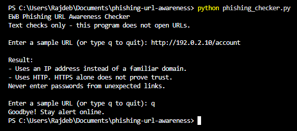
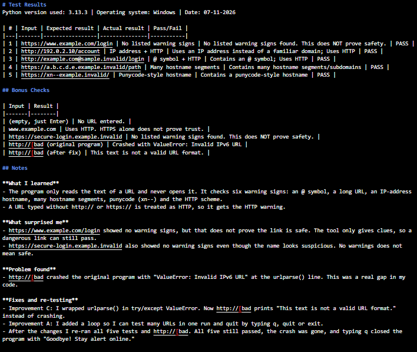

# EWB Phishing URL Awareness Checker

## Overview
Phishing is a trick where a criminal sends a fake link or message to make people share passwords, card numbers or OTPs. This project is a small Python command-line tool that reads the text of a URL and points out visible warning signs. It never opens the link, scans a website or sends any data anywhere.

## Features
- Detects an @ symbol in the URL
- Flags unusually long URLs (over 100 characters)
- Flags IP-address hostnames
- Flags many hostname segments (5 or more)
- Flags punycode-style hostnames (xn--)
- Flags the HTTP scheme
- Loop mode: check many URLs in one run and quit with q, quit or exit
- Safe handling of malformed input such as http://[bad

## Requirements
Python 3.10 or later. No extra packages.

## How to Run
Windows: `python phishing_checker.py`
Mac/Linux: `python3 phishing_checker.py`

## Example Output
```
EWB Phishing URL Awareness Checker
Text checks only - this program does not open URLs.

Enter a sample URL (or type q to quit): http://192.0.2.10/account

Result:
- Uses an IP address instead of a familiar domain.
- Uses HTTP. HTTPS alone does not prove trust.
Never enter passwords from unexpected links.

Enter a sample URL (or type q to quit): q
Goodbye! Stay alert online.
```

## Testing
Tested with Python 3.13.3 on Windows. The full table is in `tests/test_samples.md`.

| # | Input | Expected | Actual | Result |
|---|-------|----------|--------|--------|
| 1 | https://www.example.com/login | No warning signs | No listed warning signs found | PASS |
| 2 | http://192.0.2.10/account | IP address + HTTP | IP address flagged; HTTP flagged | PASS |
| 3 | http://example.com@sample.invalid/login | @ symbol + HTTP | @ symbol flagged; HTTP flagged | PASS |
| 4 | https://a.b.c.d.e.example.invalid/path | Many hostname segments | Many hostname segments flagged | PASS |
| 5 | https://xn--example.invalid/ | Punycode-style hostname | Punycode-style hostname flagged | PASS |

## Screenshots



## Improvements
1. **Loop with quit** - The original program stopped after one URL. I replaced main() with a while loop so several URLs can be checked in one run, and q, quit or exit ends the program. I tested it by entering several URLs in a row and then typing q.
2. **Malformed input handling** - Typing http://[bad crashed the original program with ValueError: Invalid IPv6 URL. I wrapped urlparse() in try/except ValueError so it now prints "This text is not a valid URL format." I re-ran all five tests and http://[bad afterwards to check that nothing broke.

## Limitations
This is an educational tool. It only reads URL text. It does not visit URLs, scan for malware or prove that a URL is safe. No warning signs found does NOT mean a URL is safe. For example, https://secure-login.example.invalid showed no warnings even though the name looks suspicious.

## Ethical Use
Use sample strings only. Do not collect credentials. Do not use this project to deceive anyone or to test websites without permission.

## Author
Rajdeb Sen, AI POWERED CYBERSECURITY INTERNSHIP, EWB Courses